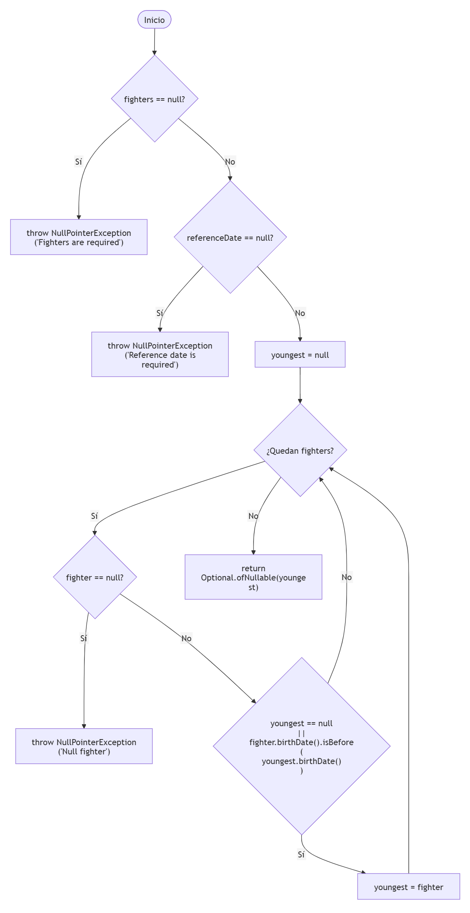
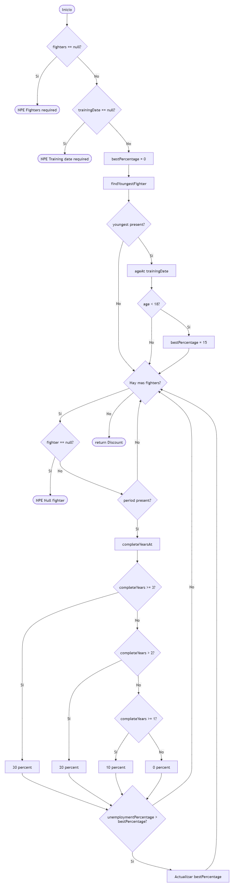

# Práctica 3 - Diseño y ejecución de pruebas de software de caja blanca y de caja negra

## Resolución del grupo

### Integrantes, responsabilidades y enlaces de integración

| Integrante | Caja blanca: métodos de dominio | Caja negra: interfaz |
|---|---|---|
| **Paula Mei Zaragoza Villegas** | `containsAllRequiredWeapons` y `DojoSearchService.findFirstAvailableDojo`  | Búsqueda de dojos (`/dojos`) |
| **María Isabel Pérez Lisón** | `ReservationDiscountService.findYoungestFighter` y `calculateBestDiscount` | Costes y bonificaciones (`/coste`) |

---

## Pruebas de caja blanca 

### Grafos de flujo
#### ReservationDiscountService.findYoungestFighter

#### ReservationDiscountService.calculateBestDiscount

### Complejidad ciclomática
#### ReservationDiscountService.findYoungestFighter
**Fórmula 1**  
V(G) = P+1 siendo P=5 --> V(G) = 6  
**Fórmula 2**  
El grafo contiene múltiples salidas excepcionales y un retorno normal. 
Para aplicar formalmente la expresión V(G)=E-N+2 debe considerarse un nodo final común al que converjan todas las terminaciones del método.  
**Fórmula 3**  
V(G) = R = 6  

**Conclusión**
La complejidad ciclomática del método es: V(G) = 6

#### ReservationDiscountService.calculateBestDiscount
**Fórmula 1**  
V(G) = P+1 siendo P=11 --> V(G) = 12  
**Fórmula 2**  
El grafo contiene múltiples salidas excepcionales y un retorno normal. 
Para aplicar formalmente la expresión V(G)=E-N+2 debe considerarse un nodo final común al que converjan todas las terminaciones del método.  
**Fórmula 3**  
El número de regiones debe contabilizarse sobre el grafo definitivo considerando el nodo final común.  

**Conclusión**
La complejidad ciclomática del método es: V(G) = 12

### Caminos independientes 
| Método | Nodo o camino identificado | Datos de entrada y fecha | Resultado esperado según especificación | Nombre del test | Resultado ejecución |
|---|---|---|---|---|---|
| findYoungestFighter | C1: fighters nulo | fighter=null, referenceDate=2026-10-20 | NullPointerException("Fighters are required") | Pendiente | Pendiente |
| findYoungestFighter | C2: referenceDate nula | fighters=lista vacía, referenceDate=null | NullPointerException("Reference date is required") | Pendiente | Pendiente |
| findYoungestFighter | C3: lista vacía | fighters=[], referenceDate=2026-10-20 | Optional.empty() | Pendiente | Pendiente |
| findYoungestFighter | C4: fighter nulo dentro de la lista | fighters=[null], referenceDate=2026-10-20 | NullPointerException("Null fighter") | Pendiente | Pendiente |
| findYoungestFighter | C5: un único fighter válido | fighters=[fighter1], referenceDate=2026-10-20 | Optional.of(fighter1) | Pendiente | Pendiente |
| findYoungestFighter | C6: varios luchadores válidos y comparación de fechas de nacimiento | fighters=[fighter1, fighter2], referenceDate=2026-10-20 | Devuelve el fighter con la fecha de nacimiento más reciente (según la especificación, el más jóven) | Pendiente | Pendiente |
| calculateBestDiscount | C1: fighters nulo | fighters=null, trainingDate=2026-10-20 | NullPointerException("Fighters are required") | Pendiente | Pendiente |
| calculateBestDiscount | C2: trainingDate nula | fighters=[], trainingDate=null | NullPointerException("Training date is required") | Pendiente | Pendiente |
| calculateBestDiscount | C3: lista vacía | fighters=[], trainingDate=2026-10-20 | Discount(0) | Pendiente | Pendiente |
| calculateBestDiscount | C4: fighter más joven con menos de 18 años | lista con un fighter de 17 años, trainingDate=2026-10-20 | Discount(15) | Pendiente | Pendiente |
| calculateBestDiscount | C5: fighter más joven con 18 años o más | lista con fighters adultos | Discount(0) | Pendiente | Pendiente |
| calculateBestDiscount | C6: fighter nulo en la lista | fighters=[null], trainingDate=2026-10-20 | NullPointerException("Null fighter") | Pendiente | Pendiente |
| calculateBestDiscount | C7: desempleo menor de 1 año | fighter con desempleo de menos de 1 año completo | Discount(0) | Pendiente | Pendiente |
| calculateBestDiscount | C8: desempleo de 1 año completo | fighter con desempleo de exactamente 1 año | Discount(10) | Pendiente | Pendiente |
| calculateBestDiscount | C9: desempleo de 2 años completos | fighter con desempleo de exactamente 2 años | Discount(20) | Pendiente | Pendiente |
| calculateBestDiscount | C10: desempleo de 3 años completos o más | fighter con desempleo >= 3 años | Discount(30) | Pendiente | Pendiente |
| calculateBestDiscount | C11: concurren descuento juvenil y descuento por desempleo | fighter menor de 18 años y fighter con desempleo >= 3 años | Discount(30), aplicando únicamente el mayor descuento | Pendiente | Pendiente |
| calculateBestDiscount | C12: descuento calculado no supera el actual | bestPercentage ya contiene un valor superior | Se conserva el porcentaje mayor | Pendiente | Pendiente |

### Cobertura de condiciones seleccionadas
| Condicion atomica | Caso que evalua verdadero | Caso que evalua falso | Casos adicionales | Justificacion si no es factible |
|---|---|---|---|---|
| `youngest==null` | Primer fighter de una lista no vacía | Segundo o posteriores fighters de la lista | Ninguno | Factible |
| fighter.birthDate().isBefore(youngest.birthDate()) | Fighter con fecha de nacimiento anterior a la almacenada en `youngest` | Fighter con fecha de nacimiento igual o posterior a la almacenada en `youngest` | Ninguno | Factible |
| Cortocircuito del operador `||` | Cuando `youngest==null` es verdadero | No aplica | Lista no vacía con un único fighter | La segunda condición no se evalúa debido al cortocircuito del operador `||` |

La decisión analizada está formada por dos condiciones atómicas unidas mediante el operador lógico `||`.  
Cuando la condición `youngest == null` toma el valor verdadero, Java realiza evaluación por cortocircuito y no evalúa la segunda condición fighter.birthDate().isBefore(youngest.birthDate())`).  
Por ello se han diseñado casos que permiten observar la evaluación verdadera y falsa de ambas condiciones, así como la situación en que la segunda condición no llega a evaluarse.

## Pruebas de caja negra

### Clases de equivalencia
| Código de clase | Variable | Condición de pertenencia | Válida / inválida | Comportamiento exigido |
|---|---|---|---|---|

### Casos
| ID del caso | Clases cubiertas | Equipo/dojo/fecha o URL concreta | Estado inicial | Resultado único esperado | Nombre prueba |
|---|---|---|---|---|---|

### Valores límite
| Variable | Valor del límite | Valor elegido | Expectativas |
|---|---|---|---|

## Material adicional

**Enlace al vídeo externo (oculto/no listado):** *completar*.
